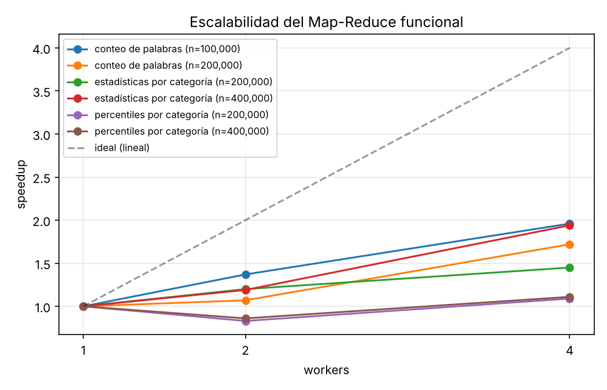

# Proyecto 7: Sistema de Agregación y Análisis de Datos Distribuidos

Sistema funcional en Python que **agrega y analiza datos de múltiples fuentes
distribuidas** con el patrón **Map-Reduce** en paradigma funcional puro: datos
inmutables, funciones puras, evaluación perezosa y agregación basada en
**Monoids y Semigroups**.

**Materia:** Programación Funcional, Ingeniería en Computación Inteligente,
Universidad de Colima.

**Profesor:** Sebastián González Zepeda.

**Equipo:** 
Camila Gaitan Guzman 20221261
Ailed Camila Gudiño 20224860


## Entregables

| Semana | Entregable | Dónde |
|---|---|---|
| 1 | Framework básico de Map-Reduce funcional | `src/mapreduce.py`, `src/monoid.py`, `src/partitioners.py`, `examples/word_count.py` |
| 2 | Operadores de agregación composables | `src/aggregators.py`, `join`, `aggregate_by_key` |
| 3 | Sistema de procesamiento paralelo | ejecución paralela por particiones, `src/sources.py`, `window` |
| 4 | Casos de uso y benchmarks | `examples/sales_analytics.py`, `examples/log_analysis.py`, `benchmarks/` |

| Requisito técnico | Cómo se cumple |
|---|---|
| Implementación funcional de Map-Reduce | `MapReduce` con `map`, `flat_map`, `filter`, `reduce_by_key`, `join`, `group_by_key`... |
| Funciones de agregación composables | `Aggregator` + `combine(...)`, `.map()`, `.where()` |
| Paralelismo con inmutabilidad | `ProcessPoolExecutor` + `dataclass(frozen=True)`, tuplas y `Record` inmutable |
| Sistema de tipos para garantizar corrección | `reduce_by_key` solo acepta `Semigroup` y `aggregate` solo `Monoid`; genéricos `MapReduce[T]` |
| Monoids y Semigroups | `src/monoid.py`; leyes verificadas en las pruebas |

## Instalación

Requiere Python 3.10 o superior. El sistema usa solo la biblioteca estándar;
`pytest` sirve para las pruebas y `matplotlib` (opcional) para la gráfica de
benchmarks.

```bash
python -m venv venv
source venv/bin/activate          # Windows: venv\Scripts\activate
pip install -r requirements.txt
```

## Uso rápido

```bash
pytest -v                                 # 71 pruebas
python -m examples.word_count             # Semana 1: conteo de palabras
python -m examples.sales_analytics        # Ventas de 3 sucursales + dashboard HTML
python -m examples.log_analysis           # Monitoreo de 2 servidores web
python -m benchmarks.benchmark            # Escalabilidad (o --rapido)
python data/generate_samples.py           # Regenera los datos de ejemplo
```

```python
from src import MapReduce, SumMonoid, combine, count, mean_of, sum_of, read_csv_sources

# Map-Reduce clásico
def tokenizar(linea): return linea.lower().split()
def par_uno(p):       return (p, 1)

conteo = (
    MapReduce.of(lineas, workers=4)
    .flat_map(tokenizar)          # perezoso
    .map(par_uno)                 # perezoso
    .reduce_by_key(SumMonoid)     # aquí se ejecuta todo, en paralelo
    .sort_by_value(descending=True)
    .take(10)
    .collect()
)

# Agregación composable sobre varias fuentes (GROUP BY distribuido)
ventas = read_csv_sources(["centro.csv", "norte.csv"], {"monto": float}).data
por_sucursal = ventas.aggregate_by_key(
    "source",
    combine(ventas=count(), ingreso=sum_of("monto"), ticket=mean_of("monto")),
).collect()
```

## Estructura

```
src/
  monoid.py         Semigroup, Monoid e instancias; product_monoid; leyes
  partitioners.py   chunk, hash_partition (shuffle), range_partition
  mapreduce.py      Motor Map-Reduce inmutable, perezoso y paralelo
  aggregators.py    Agregadores composables (stats, percentiles, top-k)
  sources.py        Lectura paralela de múltiples CSV; Record inmutable
examples/           word_count, sales_analytics (dashboard), log_analysis
benchmarks/         benchmark.py, resultados.md/.csv, speedup.png
data/               generate_samples.py y data/samples/*.csv
docs/arquitectura.md  Diseño, decisiones y análisis de rendimiento
tests/              71 pruebas
```

## Ideas clave

1. **Asociatividad = paralelismo.** Si `combine` es asociativa, cada worker
   reduce su partición y luego se combinan los parciales con el mismo
   resultado que en secuencial.
2. **Promedio, varianza y percentiles no son monoids, pero sus resúmenes sí**:
   `(suma, n)`, `(n, media, M2)` e histograma. Un `Aggregator` separa
   `prepare → monoid → present`.
3. **Componer monoids da otro monoid**: `combine(n=count(), total=sum_of(...))`
   calcula todo en una sola pasada.
4. **Lazy + fusión**: las transformaciones se encadenan y se ejecutan juntas en
   cada worker, sin mover datos intermedios.

Detalles en [`docs/arquitectura.md`](docs/arquitectura.md).

## Resultados



Con 4 workers: conteo de palabras ≈ 1.9x y estadísticas por categoría ≈ 1.9x.
Los percentiles apenas mejoran, porque el costo de serializar datos entre
procesos domina. Análisis completo en
[`benchmarks/resultados.md`](benchmarks/resultados.md) y en la sección 6 de la
arquitectura.

## Componente de emprendimiento

**Producto:** servicio de *inteligencia de negocios para PyMEs con varias
sucursales*.

* **Problema:** las PyMEs tienen sus ventas dispersas en archivos de cada
  sucursal y no pueden pagar plataformas de big data como Snowflake o
  Databricks.
* **Solución:** se consolidan las fuentes en paralelo en hardware propio y se
  genera un dashboard con ingreso por sucursal, por mes, margen por categoría y
  top de ventas (`examples/sales_analytics.py` → `data/output/dashboard_ventas.html`).
* **Otros servicios:** monitoreo de servidores y análisis de logs
  (`examples/log_analysis.py`), detección de anomalías en transacciones.
* **Modelo:** suscripción mensual por número de sucursales más configuración
  inicial.
* **Ventaja:** sin dependencias pesadas ni costos de nube, y resultados
  correctos por construcción gracias a los monoids.

## Referencias

1. Dean, J., & Ghemawat, S. (2008). MapReduce: Simplified data processing on
   large clusters. *Communications of the ACM, 51*(1), 107–113.
   https://doi.org/10.1145/1327452.1327492
2. Dean, J., & Ghemawat, S. (2010). MapReduce: A flexible data processing
   tool. *Communications of the ACM, 53*(1), 72–77.
   https://doi.org/10.1145/1629175.1629198
3. Yu, Y., Gunda, P. K., & Isard, M. (2009). Distributed aggregation for
   data-parallel computing: Interfaces and implementations. *Proceedings of the
   ACM SIGOPS 22nd Symposium on Operating Systems Principles (SOSP '09)*,
   247–260. https://doi.org/10.1145/1629575.1629600
4. Zaharia, M., et al. (2016). Apache Spark: A unified engine for big data
   processing. *Communications of the ACM, 59*(11), 56–65.
   https://doi.org/10.1145/2934664
